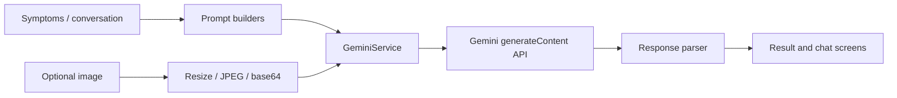

# Dr. Chatbot

A Flutter prototype exploring conversational health interfaces with Google's Gemini API. It combines guided symptom questions, optional image input, general health conversations, and structured response screens.

**Flutter · Dart · Gemini API · HTTP · Image Picker**

[Get started](docs/SETUP.md) · [How it works](#how-it-works) · [Limitations](#scope-and-limitations) · [Contribute](CONTRIBUTING.md)

> Educational prototype. Generated responses are not a medical diagnosis or a substitute for professional care.

## What you can explore

| Flow | Implementation |
| --- | --- |
| Guided skin questions | Location/symptom selection and follow-up conversation screens |
| Optional image input | Camera/gallery selection, compression, and base64 encoding |
| General health conversation | Separate question and chat screens |
| Structured presentation | Prompt builders, a response parser, and result widgets |
| App navigation | Home tabs, drawer, and shared theme configuration |

This repository includes the **Flutter UI and API integration**. It does not contain a separately trained model, a training dataset, or an independent inference server.

## Get started

Use **Flutter 3.35+ with Dart 3.9+** to match the committed dependency lockfile. Although `pubspec.yaml` allows an older Dart version, the lockfile has higher requirements.

```bash
git clone https://github.com/Imranxhah/dr_chatbot.git
cd dr_chatbot
flutter pub get
```

Create your local configuration:

```powershell
# Windows PowerShell
Copy-Item config.example.json config.local.json
```

```bash
# macOS / Linux
cp config.example.json config.local.json
```

Set `GEMINI_API_KEY` in `config.local.json` to your own development key, then run:

```bash
flutter devices
flutter run -d <device-id> --dart-define-from-file=config.local.json
```

The local file is ignored by Git. See the [setup guide](docs/SETUP.md) for model configuration, image/platform constraints, and troubleshooting.

## How it works



| Location | Purpose |
| --- | --- |
| [lib/screens](lib/screens) | Navigation, conversations, image selection, and results |
| [lib/services/gemini_service.dart](lib/services/gemini_service.dart) | API requests, timeout, and error mapping |
| [lib/services/prompt_builder.dart](lib/services/prompt_builder.dart) | Guided conversation prompts |
| [lib/services/general_prompt_builder.dart](lib/services/general_prompt_builder.dart) | General conversation prompts |
| [lib/services/response_parser.dart](lib/services/response_parser.dart) | Extract sections from model responses |
| [lib/services/image_service.dart](lib/services/image_service.dart) | Image picking, compression, and encoding |
| [lib/config/app_constants.dart](lib/config/app_constants.dart) | Model, request settings, labels, and API-key input |

## Scope and limitations

- The source currently selects `gemini-2.5-flash-lite`. Availability and permissions depend on the API provider and your account.
- Text and optional images are sent to the configured external API. Use synthetic demo inputs and avoid private patient information.
- Client build variables remove keys from source control; they do **not** make a key secret inside a shipped application. Use a server-side integration for a public deployment.
- The image service uses `dart:io`. Platform folders alone do not establish full web or desktop support.
- The existing widget test references an older package name and the default counter app. It needs replacement before it can serve as a useful test suite.
- No clinical evaluation, diagnostic accuracy study, or production reliability benchmark is included.

The cover is an abstract illustration, not a screenshot or a representation of clinical validation.

## Contributing

See [CONTRIBUTING.md](CONTRIBUTING.md). Useful contributions include reproducible setup fixes, parser robustness, accessibility, and tests with mocked API responses.

No license file is included. Contact the owner to clarify reuse terms.

Built by [Imran Shah](https://github.com/Imranxhah).
